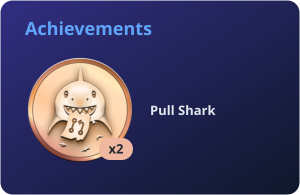

<h1 align="center">Hi, I'm Abdul Samad 👋</h1>

  Full-stack &amp; AI developer · Islamabad, Pakistan

  
  

---

### 👋 About me

I'm a full-stack developer who enjoys taking an idea all the way from a rough sketch to something people actually use. I'm comfortable moving between the frontend, the backend and the database, and I like owning the whole picture rather than just one layer of it.

A big part of what I do today is building with AI. I work with LLMs to create AI-powered applications: RAG systems that let models answer from real, up-to-date data, agentic AI that can plan and take actions with tools, and AI workflows that automate multi-step tasks end to end. I'm most interested in making these systems reliable and genuinely useful, not just impressive in a demo.

Around that, I build web apps with React and Next.js, write APIs and data pipelines in Node.js, and model data in PostgreSQL. I have a soft spot for problems that mix the real world with software, like maps and location data or keeping messy data in sync between systems. In my spare time I like experimenting with real-time features like chat and video calling, and trying out mobile development with React Native.

I care about clean, readable code, interfaces that feel simple to use, and shipping things that solve a real problem.

### 🛠️ Tech stack

  
  
  
  
  
  
  
  
  
  
  
  
  
  
  
  
  
  
  
  

### 📊 GitHub stats

  
  

  
  

### 📫 Get in touch

Find my work and contact details on my **[portfolio](https://abdulsamad-portfolio.vercel.app)**.
